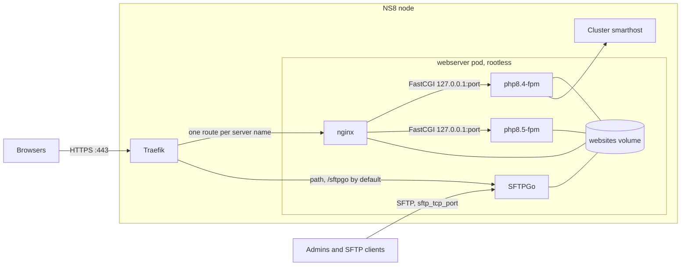

# ns8-webserver

A NethServer 8 module to host static and PHP websites. It runs nginx, one
php-fpm container per PHP version in use, and SFTPGo to upload the files.
Databases are not part of this module, see
[ns8-mariadb](https://github.com/NethServer/ns8-mariadb).



Each virtual host gets an ID, which is also the TCP port of its php-fpm pool:
9001, 9002 and so on. The ID names its web root, its SFTP user and its
configuration files.

[Admin guide](docs/admin-guide.md): settings, virtual hosts, uploading files,
custom configuration, hardening, backup and restore, troubleshooting.

[Architecture](docs/architecture.md): pod and network, systemd units,
configuration rendering, Traefik routes, module state, PHP images and
extensions.

## Install

```sh
add-module ghcr.io/nethserver/webserver:latest 1
```

The output returns the instance name, for example `webserver1`.

## Configure

Fill in the Settings page, or:

```sh
api-cli run module/webserver1/configure-module --data '{"path": "/sftpgo", "http2https": true, "sftp_tcp_port": 3092, "sftpgo_service": true}'
```

Then create a virtual host in the Virtual hosts page, or with `create-vhost`,
see [Virtual hosts](docs/admin-guide.md#virtual-hosts).

SFTPGo starts with the `admin` / `admin` account. Change it at the first login.

## Uninstall

```sh
remove-module --no-preserve webserver1
```

## Testing

```sh
./test-module.sh <NODE_ADDR> ghcr.io/nethserver/webserver:latest
```

The tests use [Robot Framework](https://robotframework.org/).

## UI translation

Translated with [Weblate](https://hosted.weblate.org/projects/ns8/).

To set up the translation process:

- add the [GitHub Weblate app](https://docs.weblate.org/en/latest/admin/continuous.html#github-setup) to your repository
- add your repository to [hosted.weblate.org](https://hosted.weblate.org) or ask a NethServer developer to add it to the ns8 Weblate project
