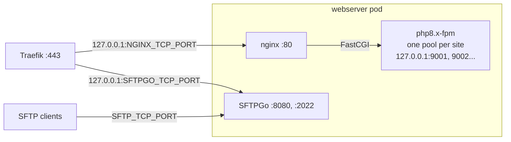
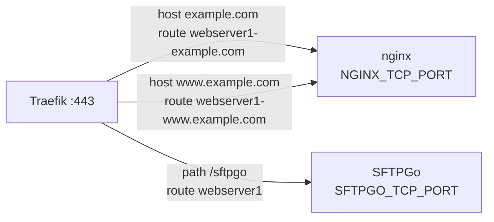
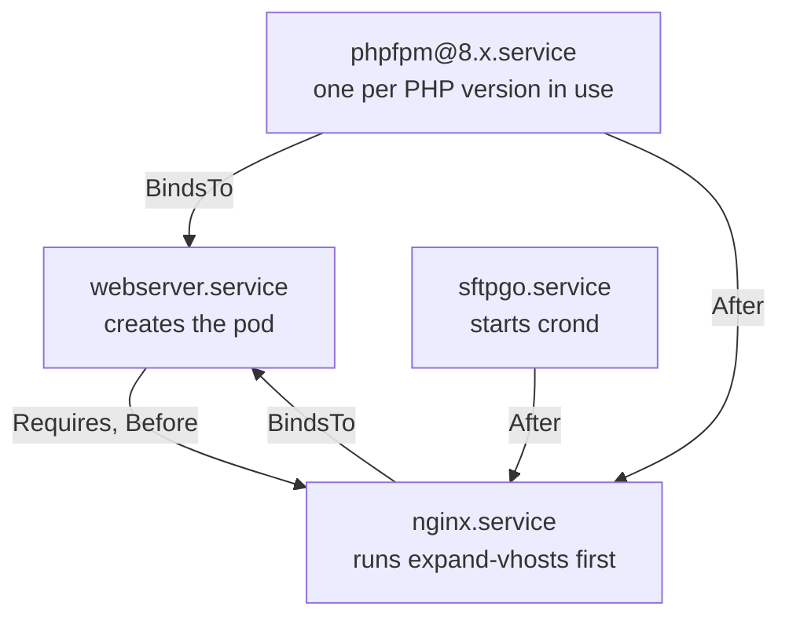
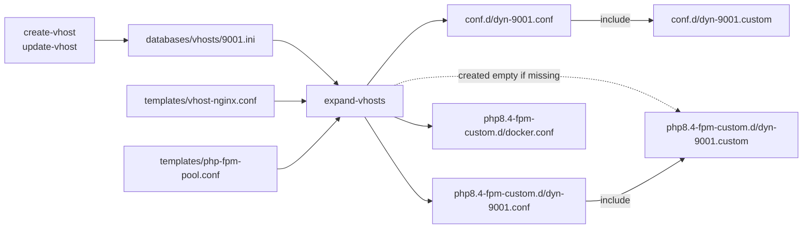

# Architecture

The paths below are relative to the module state folder,
`/home/webserver1/.config/state/` for the instance `webserver1`.

## Network

Every container runs in one rootless pod, `webserver`, with slirp4netns. The
pod publishes three ports:

| Host port | Container port | Service |
| --- | --- | --- |
| `127.0.0.1:NGINX_TCP_PORT` | 80 | nginx, behind Traefik |
| `127.0.0.1:SFTPGO_TCP_PORT` | 8080 | SFTPGo web interface, behind Traefik |
| `SFTP_TCP_PORT`, all interfaces | 2022 | SFTP, opened in the firewall when `sftpgo_service` is true |

`NGINX_TCP_PORT` and `SFTPGO_TCP_PORT` are the two ports the node allocates at
install time. `SFTP_TCP_PORT` is chosen by the admin.



Inside the pod the containers share one network namespace. Each PHP pool
listens on `127.0.0.1:<ID>`, and nginx reaches it there. Two sites on the
same PHP version share one php-fpm container but have two pools.

nginx trusts `X-Forwarded-For` from any address, because only Traefik can
reach it on `127.0.0.1`. The logs show the real client address.

## Storage

The `websites` volume holds one folder per site, named after its ID. Each
container mounts it at a different place:

| Container | Mount point | Web root of site 9001 |
| --- | --- | --- |
| nginx | `/usr/share/nginx/html` | `/usr/share/nginx/html/9001` |
| php-fpm | `/var/www/html` | `/var/www/html/9001` |
| SFTPGo | `/srv/sftpgo/data` | `/srv/sftpgo/data/9001` |

The SFTP user `9001` writes with uid 1 and gid 9001. The pool of site 9001
runs as `daemon` (uid 1) with group 9001. Every pool runs as uid 1, which
is why one site can read the files of the others.

## Traefik routes



Every server name of every site gets its own route,
`<module_id>-<server name>`, with its own `lets_encrypt` and `http2https`.
nginx then picks the site from the `Host` header. The SFTPGo route is a path
route on every host name of the node.

`update-vhost` deletes the routes of the old server names before it creates
the new ones. `destroy-vhost`, `destroy-module`, `restore-module` and
`clone-module` walk the virtual host settings to delete or recreate the
routes.

## systemd units



`phpfpm@.service` is a template. Its instance name is the PHP version, so
`phpfpm@8.4.service` runs the container `php8.4-fpm` from the image
`ghcr.io/nethserver/php8.4-fpm`. It starts only when
`php8.4-fpm-custom.d/` is not empty. The actions enable it when a site needs
that version and disable it when no site uses it anymore.

Reloading nginx runs `expand-vhosts` again, then sends `HUP`. Reloading a
php-fpm unit sends `USR2`, which reloads the pools without dropping
requests.

## Configuration rendering

The source of truth is one ini file per site. `expand-vhosts` renders the
nginx and php-fpm configuration from it every time nginx starts or reloads.



`expand-vhosts` first deletes every `dyn-*.conf`, then writes them again
for the enabled sites. A disabled site gets no configuration at all. The
`*.custom` files are never touched, and they are what the admin edits.

The site ID comes from `databases/NextFpmPort`, which holds the last ID
given. `create-vhost` increments it. IDs are never reused.

## Module state

| Path | Content | Backed up |
| --- | --- | --- |
| `environment` | ports, SFTPGo path, `http2https`, `sftpgo_service` | partly, through the restore request |
| `databases/vhosts/<ID>.ini` | settings of one site | yes |
| `databases/NextFpmPort` | last ID given | yes |
| `conf.d/dyn-<ID>.conf` | nginx server block, rendered | no |
| `conf.d/dyn-<ID>.custom` | nginx custom file | yes |
| `php<ver>-fpm-custom.d/dyn-<ID>.conf` | php-fpm pool, rendered | no |
| `php<ver>-fpm-custom.d/dyn-<ID>.custom` | php-fpm custom file | yes |
| `php<ver>-fpm-custom.d/docker.conf` | php-fpm global settings, copied | no |
| `customs/nginx.conf` | main nginx configuration | no, shipped with the module |
| `sftpgo.conf.d/admin.json` | SFTPGo initial admin account | no, shipped with the module |
| `sftpgo.conf.d/API_KEY` | SFTPGo API key used by the actions | yes |
| `crontabs/` | crontab of the SFTPGo container | yes |
| `smarthosts/smarthost.env` | smarthost settings, discovered | no |
| `image_url_tag.env` | tag of the PHP images to run | no |

The volumes `websites`, `sftpgo_config` and `sftpgo_backups` are backed up
too. See `imageroot/etc/state-include.conf`.

## SFTPGo

SFTPGo starts with the account from `sftpgo.conf.d/admin.json`, `admin` /
`admin`. The first `configure-module` uses it to create an API key, stored in
`sftpgo.conf.d/API_KEY`. `create-vhost` and `destroy-vhost` call the SFTPGo
REST API with that key to add or remove the site user.

## Smarthost

`phpfpm@.service` runs `discover-smarthost` before it starts. It writes the
cluster smarthost settings from Redis to `smarthosts/smarthost.env`, which is
passed to the container with `--env-file`. The pools have `clear_env = no`,
so PHP sees the variables:

```
SMTP_ENABLED=1
SMTP_HOST=10.5.4.1
SMTP_PORT=25
SMTP_USERNAME=
SMTP_PASSWORD=
SMTP_ENCRYPTION=none
SMTP_TLSVERIFY=
```

The `smarthost-changed` event restarts every php-fpm unit in use, so the new
values are read.

## Actions

| Action | What it does |
| --- | --- |
| `create-module` | stores the two allocated ports, creates the pod |
| `configure-module` | validates the path and the SFTP port, opens the firewall, sets the SFTPGo route, starts SFTPGo, creates the API key |
| `create-vhost` | writes the site ini, creates the SFTP user and the web root, starts the php-fpm unit, sets the routes |
| `update-vhost` | replaces the routes, rewrites the site ini, starts or stops php-fpm units |
| `destroy-vhost` | deletes the site ini, its web root, its SFTP user, its php-fpm custom file and its routes |
| `get-configuration` | returns the sites and the SFTPGo settings |
| `restore-module` | restores the environment, recreates the routes, starts the services |
| `clone-module` | recreates the routes, pulls the PHP images in use |
| `destroy-module` | deletes every route and closes the SFTP port |

## Update

`update-module.d/` runs on every module update:

- `10fix_NextFpmPort` makes sure `NextFpmPort` is not lower than the highest
  existing ID
- `15clean-php-images` removes the PHP images that no container uses
- `20restart` restarts the pod and SFTPGo, then pulls the PHP images of the
  new release and restarts the php-fpm units in use

The PHP images carry the same tag as the module image. `download-php-fpm`
reads the tag from `IMAGE_URL`, writes it to `image_url_tag.env`, and pulls
the image if it is missing.

## PHP images

`build-images.sh` builds one image per PHP version from the official
`php:<version>-fpm` image. The versions and their base images are listed in
`PHP_VERSIONS` at the top of the script. PHP 7.4 and 8.0 use Debian
bullseye, the others bookworm.

To add a PHP version, add it to `PHP_VERSIONS`, to the PHP version dropdown in
`ui/src/views/VirtualHosts.vue`, and to the `PhpVersion` description of the
action schemas.

### Extensions

The extensions are declared in two files, and nowhere else:

- `container/php-extensions.list`, built with `docker-php-ext-install`
- `container/pecl-extensions.list`, built with `pecl install`, in build order

The build reads them to install the extensions and to check they are loaded.
`container/verify-runtime.php`, shipped in the image, reads the same files.

To add an extension, add its name to the right list and its check to
`verify-runtime.php`. The check is not optional. The build fails with
`No runtime check for: <name>` when a listed extension has none, because
`php -m` proves nothing. It lists `gd` whether or not it was built with WebP,
and `pdo_mysql` whether or not the driver registered.

A check returns `true`, or the message to print:

```php
'zip' => fn() => class_exists('ZipArchive'),
```

A build dependency goes to `PHP_BUILD_DEPS` in the `Containerfile`, a runtime
library to the `apt install` list of the matching Debian release.

`imap` and OPcache are checked without being listed. `imap` is built from
source or from PECL depending on the PHP version, and OPcache comes from the
base image. Extra checks are allowed, a listed extension without a check is
not.

### Build failures

| Exit code | Meaning |
| --- | --- |
| 10, 11 | `imap` or a PECL extension failed to build |
| 20 | extension missing from `php -m` |
| 30 | missing `.so` file |
| 40 | a shared library of the `.so` is not found |
| 50 | extension loaded but not usable, or a listed extension with no check |

`tests/webserver.robot` runs `verify-runtime.php` in every PHP version, and
also serves it through nginx and php-fpm, so the whole chain is covered.
